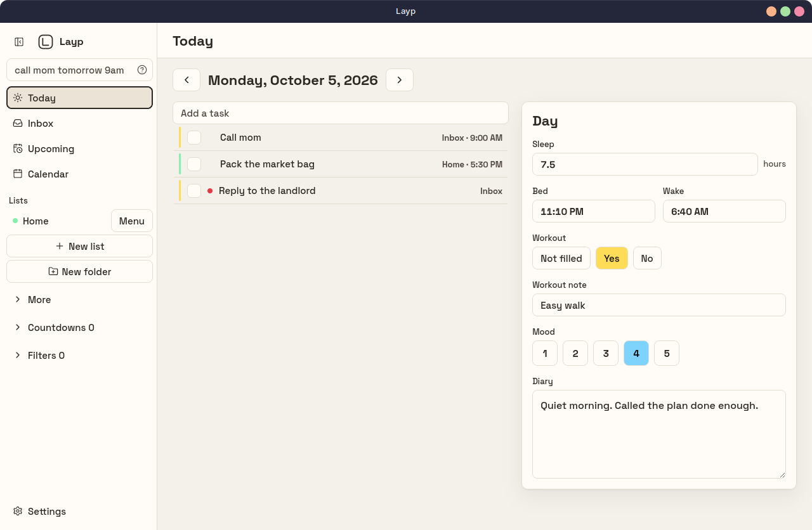
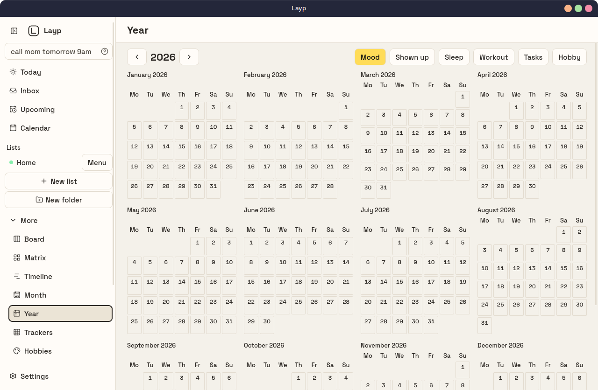
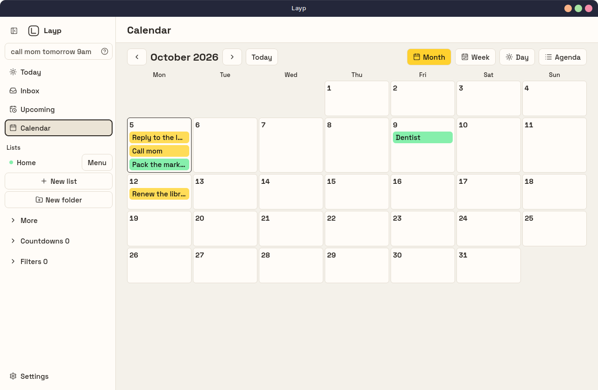

<p align="center">
  
</p>

<h1 align="center">Layp</h1>

<p align="center">
  A local planner for the day, the tasks, and the habits.<br>
  Linux on the desk. Android on the same Wi-Fi. One SQLite file on each.
</p>

<p align="center">
  
</p>

Layp is an installed program. There is no account and no cloud server. The desktop keeps its file on that computer. The phone keeps its own copy and syncs while both are open on the same Wi-Fi. A backup is a copy of the file.

The pictures on this page are the desktop. The phone uses the same names.

## Not only a todo list

A todo list ends at the checkbox. Layp keeps the day next to the tasks, and it keeps habits as their own records.

| | A usual todo app | Layp |
| --- | --- | --- |
| The day | Tasks that fall on a date | Tasks, plus sleep, workout, mood, and a diary line |
| Habits | Another list, or a streak you can break | A tracker is a check, a count, or a number. A hobby is minutes you spent, with no daily debt |
| The year | A calendar of due dates | The same year can show mood, sleep, workout, tasks, or hobby time |
| Where it lives | An account | A file on the computer. The phone is a second copy, not a login |
| Repeats | A pile of future copies | The next copy appears when you finish the current one |

<p align="center">
  
</p>

## Screens

<p align="center">
  
</p>

The sidebar opens on Today, Inbox, Upcoming, and Calendar. Lists and folders sit under those. More holds the rest. The phone opens on Today, Inbox, Calendar, and Focus, and keeps the rest under More.

| Screen | What it is for |
| --- | --- |
| Today | Tasks for the day, plus the diary, sleep, and workout line |
| Inbox | Tasks that do not have a list yet |
| Upcoming | What is scheduled next |
| Calendar | The month, with tasks on their days |
| Board | One list as columns |
| Matrix | Important and urgent |
| Timeline | The week as columns |
| Month | The month spread and the day page |
| Year | The year, a day at a time, for mood, sleep, workout, tasks, or a hobby |
| Trackers | Checks, counts, and numbers you keep |
| Hobbies | Time spent, not a daily debt |
| Focus | A work timer and a break |
| Stats | Bars, a line, or a notebook, for 7, 28, or 365 days |
| Countdowns | A date you are counting toward |
| Settings | Theme, clock, tray, backup, the phone link, and About |

Type a task in the sidebar field. `call mom tomorrow 9am` sets the title, the day, and the time. The question mark next to the field lists the words Layp understands.

## Install

The desktop package is attached to the [0.2.0 release](https://github.com/dj-secq/layp/releases/tag/v0.2.0).

```sh
curl -LO https://github.com/dj-secq/layp/releases/download/v0.2.0/Layp_0.2.0_amd64.deb
sudo apt install ./Layp_0.2.0_amd64.deb
```

Installing it adds Layp to the app menu. The package is section `utils`, priority `optional`. The desktop entry is a Productivity app. Its keywords are tasks, planner, calendar, journal, habits, trackers, todo, and focus.

`Layp_0.2.0_amd64.AppImage` on the same release is the program without a package install.

The phone file on the same release is `Layp-0.2.0.apk`. It is an arm64 Android package. Install it from the file manager. It is signed with its own key, so uninstall a development build of Layp first. The installed phone app does not need the computer's dev server.

Build the desktop package from this repo:

```sh
cd app
npm install
npm run tauri build
```

The package is written to `app/src-tauri/target/release/bundle/deb/`. The AppImage is under `bundle/appimage/`.

## Develop

Node 22 and a Rust toolchain are required, plus the WebKitGTK and GTK libraries Tauri uses on Linux. Install from `app/`, `phone/`, or `shared/`. The repo root is not a package.

```sh
cd app
npm install
npm test
npm run tauri dev
```

`npm run tauri dev` opens the Layp window.

## Phone

The phone is the same planner: tasks, the day record, trackers, hobbies, focus, and the calendar. It does not need a store account. Pair it once from Settings on the desktop. After that, edits sync while both apps are open on the same Wi-Fi.

```sh
cd phone
npm install
npm test
npx expo start
```

`android/` and `ios/` are generated and stay out of git. From `phone/`, `npm run android` rebuilds the Android project. Settings on the phone has the same About text, plus export and import of the phone's own copy.

## License

[MIT](LICENSE)
